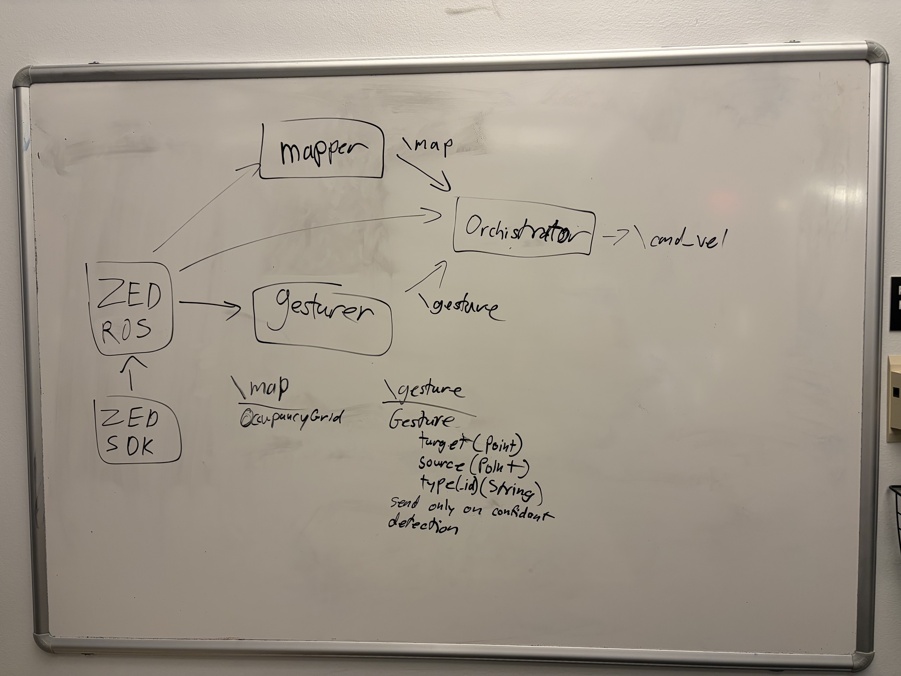

# Milestone 1

For the first week of our project we focused on our computational setup and establishing that we could interface with our hardware, the ZED M camera. We additionally established our planned nodes and their interfaces. 

## Computational setup

For this project we our using robostack as our dependency manager. River has previously developed a template to use for making a CompRobo project based in pixi available [here](https://github.com/rivques/comprobo_ros_pixi_template), which servers as our background for how to set up this project. We additionally had to download the ZED sdk which provides the software needed to connect to the ZED cameras and provides the neural networks that enables much of the ZED's built in functionality. We primarily referred to [this guide](https://docs.stereolabs.com/docs/development/zed-sdk/linux) for installation on linux.

For milestone 1, in addition to downloading dependencies and setting up a ROS workspace, we established the basic system architecture. The main challenge we face with the system architecture is that Project UNDERDOG (UNDer Engineered Robot DOG) is our final project for both CompRobo and PIE (Principles of Integrated Engineering). We decided we wanted to have two repositories, one for CompRobo and one for PIE, so we could taylor each to the classes requirements. However, we want to share most of the code between these two projects. In order to do this, our code will be spilt between two packages. A small portion is in the `underdog_interfaces` package which provides our custom message types, and the bulk of our code is in the `underdog_behaviors` submodule. The code being in a submodule means we can easily push changes to the submodule from one repository and pull them into another.

--- RIVER UPDATES WITH COOL INFO & PICTURES---
A system arch diagram would be cool

## Interfacing with hardware

StereoLabs (the producer of the ZED camera), provides a ROS2 wrapper for the SDK that allows us to interact with the camera through a node. For this milestone we aimed ...

--- AUSTIN UPDATES WITH COOL INFO & PICTURES---
Austin put whatever you do here. Pictures would be very nice.

## Establishing Interfaces and Nodes

One of our major goals for milestone 1 was to establish the message types we would use and all the nodes we would develop, at least for our MVP. By establishing the Nodes we would have, and which one each person would work on, along with how to communicate between them we can work asynchronously to improve our efficiency.

For our MVP we will make 3 nodes: the mapper node, the gesture node, and the orchestrator node.

The mapper node which will use the data from the camera to create an occupancy grid of our surroundings. This node will then broadcast the occupancy gird as a Nav2 OccupancyGrid on the /map topic. This node will subscribe to whatever topics we find we need published by the ZED Node.

The gesture node which will identify gestures made by people, where they are, and if applicable the target of the gesture (for example a position being pointed at). This node will subscribe to whatever topics are necessary (likely the published body pose estimation), and it will publish the interpreted behavior as a custom Gesture type on the /gesture topic. The Gesture type will have a header, a geometry Point source, a geometry Point target, and a String type. It will also contain constants for each valid gesture type to act as a enum.

The orchestrator node which will take map data and gesture info to preform some behavior. This node will subscribe to the /map and /gesture topics, along with whatever topics it needs from the ZED node (likely odometry related information). For the MVP this node wil implement path planning to move the robot to a position being pointed at. As a stretch goal behaviors may be moved to an action server and the orchestrator node will use the action sever as we impliment additional behaviors. 
